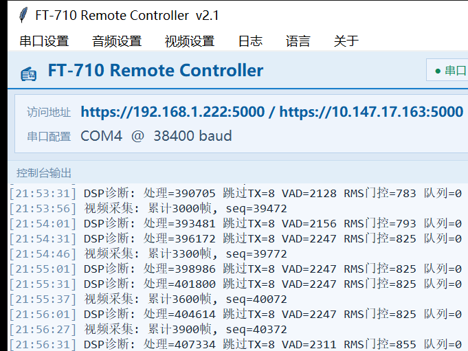
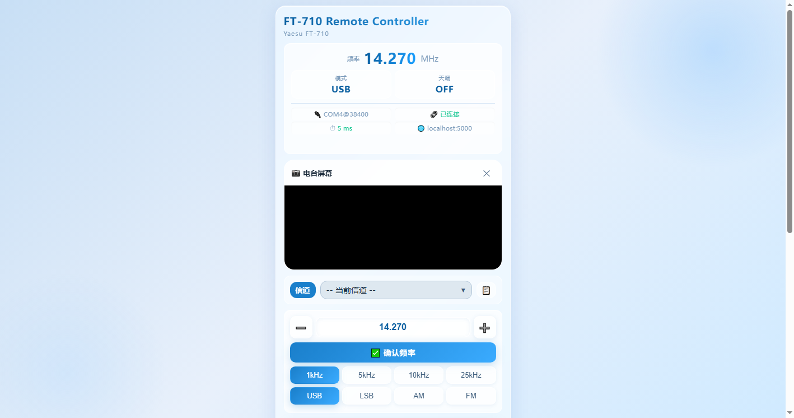

# FT-710 Remote Controller

基于 **WebRTC** 的 Yaesu FT-710 短波电台远程控制器。本机运行 tkinter 图形界面作为服务端，任意浏览器通过 HTTPS 网页即可远程操作电台（音频/视频/PTT/频率）。

> WebRTC-based remote controller for the **Yaesu FT-710** HF transceiver. A local tkinter GUI runs as the server; any browser can control the radio remotely over HTTPS (audio / video / PTT / frequency).

详细说明见 [DOCUMENTATION.md](DOCUMENTATION.md)（硬件接线、架构、配置、使用说明、API）。Full documentation: [DOCUMENTATION.md](DOCUMENTATION.md).

## 截图 / Screenshots





## 特性 / Features

- **本地图形界面**：tkinter，中/英双语（自动跟随系统语言）
- **WebRTC 低延迟音频/视频**：网页端实时收发语音（Opus/PCMU）；视频采集电台 **DVI 屏幕画面**（USB 采集卡）经 MJPEG/VP8 实时显示
- **PTT 控制**：CAT 指令控制发射/接收，300ms 超时自动重发
- **串口自适应**：自动枚举 COM 口、自动重连、波特率/电台地址可配置
- **DSP 处理**：抗混叠低通抽取、VAD 语音门控、麦克风采样率自动对齐（16k/44.1k/48k）
- **神经网络降噪（v2.2）**：DeepFilterNet3 离线推理，与 1-5 级谱减法互斥，弱语音保护可调（衰减上限 6~30dB）
- **接收稳定性（v2.2.2）**：VAD 门限默认 -55dB（低电平声卡不再误关断）、支持按声卡名称精确选设备、接收增益 0.5x~5.0x
- **设置页设备热刷新（v2.2.2）**：串口/音频/视频设置弹窗居中防溢出，一键刷新新接入设备无需重启
- **现代化桌面主题（v2.2.2）**：Apple 风格配色 + 自绘圆角按钮，设置页更清爽
- **横竖屏自适应（v2.2.2）**：横屏自动两列（左＝状态+增益/降噪/功率，右＝电台屏幕+频率/信道/PTT）
- **iOS 音量补偿（v2.2.2）**：iOS 端 Web Audio 增益补偿，解决手机端音量偏小
- **多客户端隔离**：每个 WebRTC 连接独立音频队列，慢客户端只丢自己的帧
- **视频自愈**：假死看门狗（8 秒无帧自动重启 ffmpeg）、残留进程清理、快速失败退避
- **空闲连接回收**：无数据流动 180 秒自动清理 WebRTC 连接，不留僵尸连接
- **HTTPS 自签名证书**：首次运行自动生成，支持局域网 IP/域名

## 环境要求 / Requirements

- 64 位 Windows **10 及以上**（v2.2.2 基于 Python **3.11** 打包）
- Python **3.8~3.12**（源码运行，v2.2.2 依赖见 `requirements.txt`）
- 依赖见 `requirements.txt`
- 视频功能需要 **ffmpeg**（随 exe 分发，或加入系统 PATH）
- **硬件**：电台 USB 口→电脑（虚拟声卡，音频）、电台 DVI 输出→USB 采集卡→电脑（视频）、CAT 串口（控制）

## 安装运行 / Install & Run

```bash
# 1. 安装依赖
pip install -r requirements.txt

# 2. 运行（需连接电台与音频设备）
python ft710_controller.py
```

首次运行会自动生成 `ft710_config.ini` 默认配置与自签名 SSL 证书。程序启动后，在局域网内任意设备浏览器访问：

```
https://<本机IP>:5000
```

> 浏览器提示证书不受信任时，选择"继续访问"（自签名证书）。建议使用 Chrome / Edge。

## 配置说明 / Configuration

配置文件 `ft710_config.ini`（参照 `ft710_config.example.ini`）：

| 配置节 | 说明 |
| --- | --- |
| `[SERIAL]` | COM 口、波特率 |
| `[AUDIO]` | 采样率、块大小、输入/输出声卡设备号；v2.2.2 起含 `RX_VAD_THRESHOLD_DB`（接收 VAD 门限，默认 -55）、`DEVICE_IN_NAME` / `DEVICE_OUT_NAME`（按名称精确选声卡）、`AI_ATTEN_LIM_DB`（降噪衰减上限）、`AI_INTRA_THREADS`（ORT 推理线程）、`GIL_SWITCH_INTERVAL_MS`（GIL 切换间隔，默认 0.5） |
| `[SYSTEM]` | 进程优先级 `PROCESS_PRIORITY`（默认 above_normal） |
| `[NETWORK]` | 服务端口（默认 5000） |
| `[PTT]` | PTT 模式（momentary） |
| `[VIDEO]` | 视频开关、采集参数名、分辨率/帧率/质量 |
| `[WEBRTC]` | WebRTC 音频/视频编码 |
| `[CHANNELS]` | 快捷频率按钮（160m–10m） |
| `[LANGUAGE]` | 界面语言 `zh` / `en` |

## 打包为 EXE / Build EXE

使用 PyInstaller（v2.2.2 基于 **Python 3.11** + PyInstaller 6 构建；脚本会通过 `collect_all` 打入 onnxruntime / soxr / deepfilter_stream，并把 `dfn3_model/` 与 `ffmpeg/` 目录一并打包）：

```bash
pip install pyinstaller
pyinstaller --clean --noconfirm ft710.spec
```

产物位于 `dist\ft710\`。`ft710.spec` 会把 `ffmpeg/` 目录（含全部 DLL）一并打包，exe 自包含、不依赖系统 ffmpeg。

## 目录结构 / Project Structure

```
ft710_controller.py        # 主程序（GUI 服务端 + WebRTC + DSP + Flask/SocketIO）
ft710.spec                 # PyInstaller 打包配置
build.spec                 # 备用打包配置
DOCUMENTATION.md           # 详细文档（硬件/架构/配置/使用）
gui_main.png               # GUI 界面截图
webui_main.png             # Web UI 界面截图（电台屏幕）
ft710_config.example.ini   # 配置示例
requirements.txt           # Python 依赖
LICENSE                    # MIT
THIRD_PARTY_NOTICES.md     # 第三方组件许可证声明
favicon (1).ico            # 应用图标
```

## 安全提示 / Security Notes

- 程序使用**自签名证书**与 WebRTC，适合局域网/可信网络；**请勿**直接暴露到公网
- 串口、音频、摄像头设备号为本机相关配置，请勿提交真实 `ft710_config.ini`
- 请在所在地法律法规允许范围内使用（业余无线电操作需持有相应执照）

## 协议 / License

本项目以 [MIT](LICENSE) 协议开源。

Copyright (c) 2026 [Robby Wang](https://github.com/ruibaow)

---

## English

**FT-710 Remote Controller** is a WebRTC-based remote controller for the Yaesu FT-710 HF transceiver. A tkinter GUI runs locally as the server; any browser on the LAN can operate the radio over HTTPS.

### Screenshots


### Features
- Local tkinter GUI, bilingual (zh/en)
- WebRTC low-latency audio (Opus/PCMU) and video (MJPEG/VP8)
- PTT via CAT with 300 ms retry
- Auto COM-port enumeration / reconnect
- DSP: anti-aliasing decimation, VAD gating, mic sample-rate auto-align (16k/44.1k/48k)
- Per-client WebRTC audio isolation (slow clients only drop their own frames)
- Video self-healing: 8 s no-frame watchdog restarts ffmpeg; residual-process cleanup; backoff retry
- Idle WebRTC connections recycled after 180 s of no data flow
- Auto-generated self-signed HTTPS certificate

### Requirements
- 64-bit Windows, Python **3.8**+, ffmpeg (for video; bundled with the exe build)
- **Hardware**: radio USB port → PC (virtual sound card, audio), radio DVI output → USB capture card → PC (video), CAT serial (control)

### Run
```bash
pip install -r requirements.txt
python ft710_controller.py
```
Then open `https://<LAN-IP>:5000` in Chrome/Edge (accept the self-signed cert warning).

### Build EXE
```bash
pip install pyinstaller
pyinstaller --clean --noconfirm ft710.spec
```
Output: `dist\ft710\` (self-contained, includes the whole `ffmpeg/` folder).

### License
[MIT](LICENSE). Use within your local laws (amateur radio operation requires a license where applicable).
